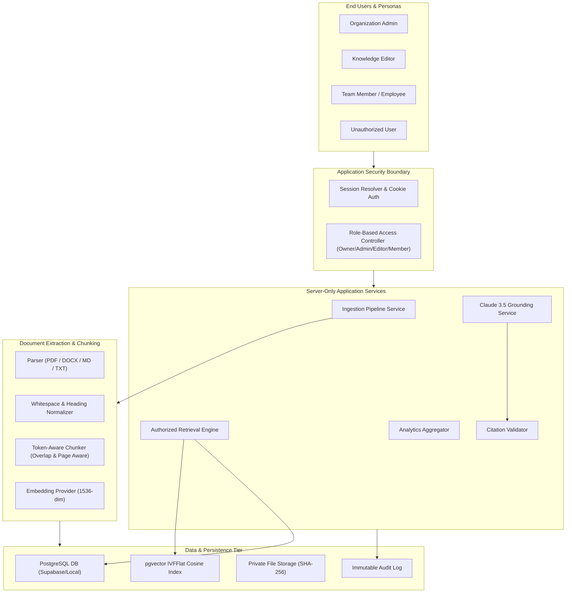
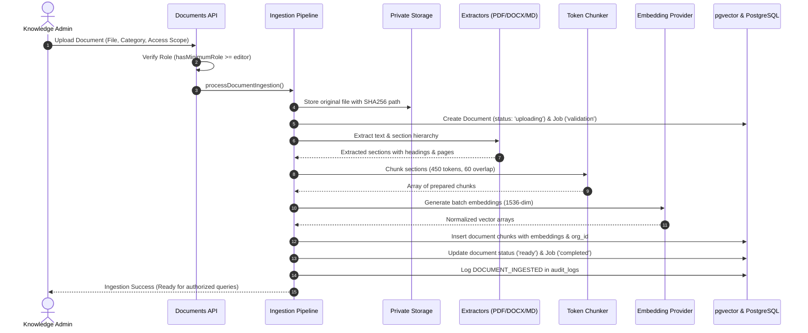
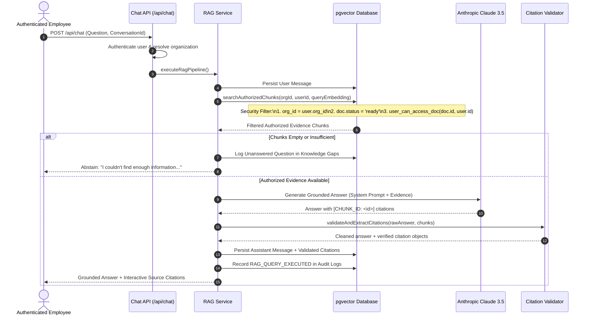
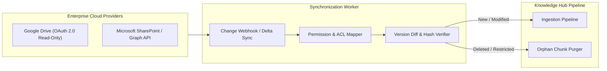

# System Architecture & Data Flow

This document details the architectural design, component boundaries, and end-to-end data flows for the **Secure Internal Knowledge Hub**.

---

## 1. High-Level System Architecture

---

## 2. Ingestion Pipeline Data Flow

---

## 3. Grounded Retrieval & Answer Generation Flow

---

## 4. Cloud Connectors Architecture (Google Drive & SharePoint)

