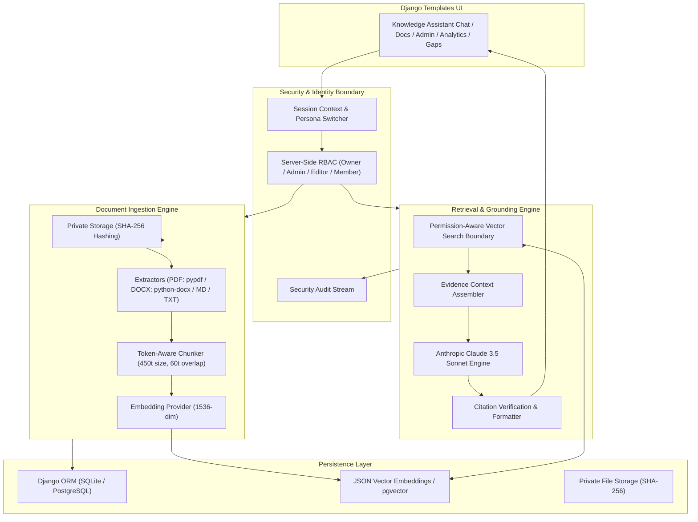
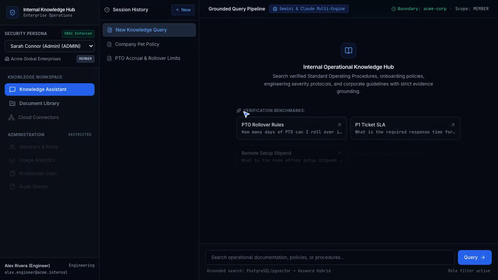
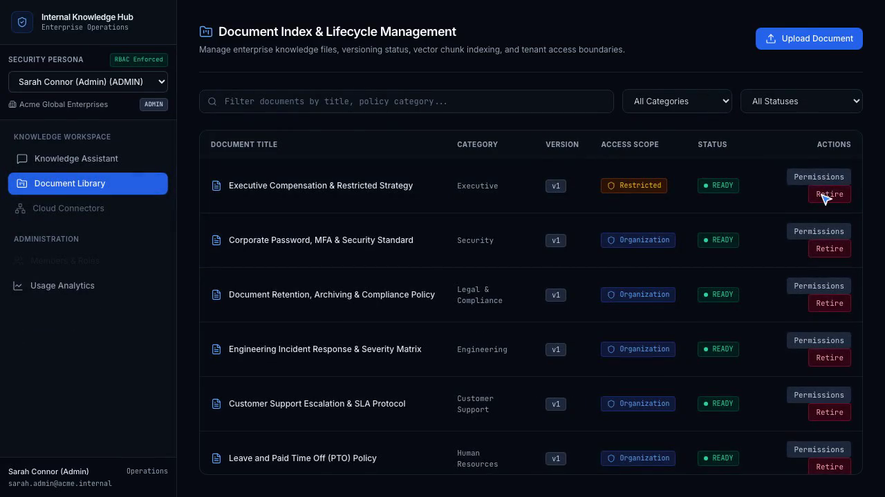
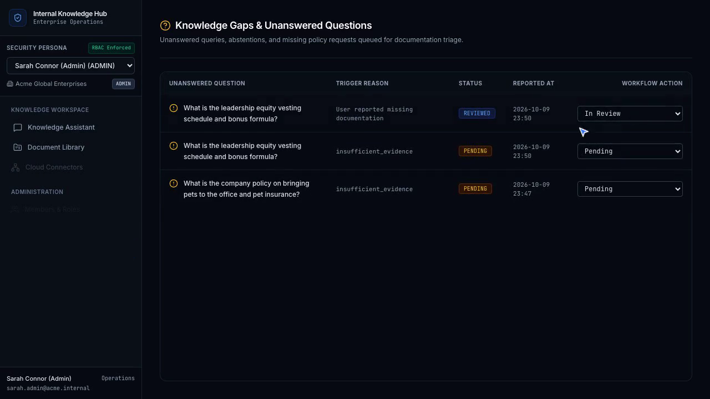
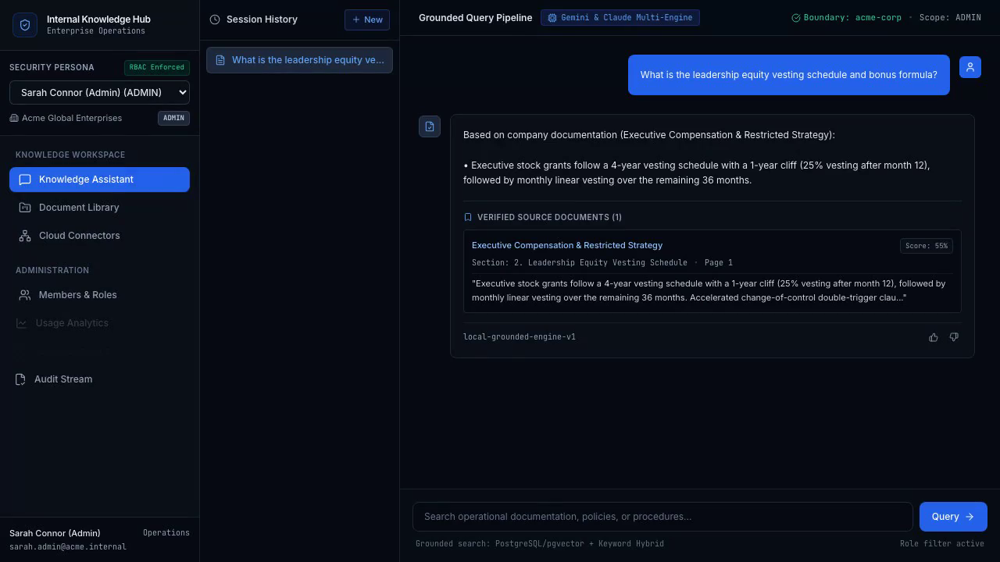

# Secure Internal Knowledge Hub (Django + Templates Enterprise RAG MVP)

[](https://www.python.org/)
[](https://www.djangoproject.com/)
[](https://ai.google.dev/)
[](https://www.anthropic.com/)
[](https://pytest.org/)
[](./SECURITY.md)

A private, multi-tenant AI knowledge assistant engineered with **Python, Django, and Django Templates** for company Standard Operating Procedures (SOPs), employee handbooks, engineering incident protocols, compliance policies, and operational documentation.

Built with a **security-first retrieval architecture**, strictly grounded **Google Gemini** & **Anthropic Claude** generation, server-side validated source citations, explicit insufficient-evidence abstention, lifecycle document management, and administrative knowledge-gap observability.

---

## 🌟 Key Capabilities

1. **Permission-Aware Vector Retrieval Boundary**
   - Retrieval queries are filtered **at the database level** by tenant organization, document lifecycle status (`ready`), and fine-grained role/user access rules before chunks ever reach the LLM context.
   - Unauthorized chunks are never loaded into memory.

2. **Grounded Answer Generation & Citation Validation**
   - Versioned enterprise system prompt instructs Claude to answer exclusively from retrieved evidence.
   - Server-side citation verification matches every cited claim to real, accessible chunk IDs and formats rich previews with section headings and page numbers.

3. **Autonomous Abstention on Insufficient Evidence**
   - When documentation is missing or access is restricted, the assistant reliably abstains: *"I couldn't find enough information in the documents you have access to answer this reliably."*
   - Abstentions automatically feed into the **Knowledge Gaps** workflow for administrative review.

4. **Multi-Format Ingestion Pipeline**
   - Supports **PDF** (`pypdf`), **DOCX** (`python-docx`), **Markdown**, and **TXT** files.
   - Token-aware semantic chunker with heading path preservation (`#`, `##`, `###`), page number tracking, and sliding overlap.

5. **Document Lifecycle & Stale Chunk Invalidation**
   - Instant document retirement: retired documents are immediately unsearchable in retrieval without orphan chunk contamination.
   - In-place document re-indexing replaces obsolete chunk embeddings cleanly.

6. **Enterprise Governance & Observability**
   - Real-time Analytics Dashboard tracking query volume, user satisfaction, abstention rate, top-cited documents, and queried policy topics.
   - Immutable security audit stream logging all ingestion, permission, and role changes.

7. **Dual-Mode Zero-Config Engine**
   - **Local / Demo Mode**: Runs instantly out of the box with zero external dependencies (pure in-memory vector cosine math and deterministic embedding projection).
   - **Production Mode**: Seamlessly connects to **PostgreSQL + pgvector**, **Anthropic Claude 3.5 Sonnet**, and **OpenAI/Voyage** embeddings via standard environment variables.

---

## 🏗️ Architecture Overview



---

## 🚀 Quickstart & Setup

### 1. Set Up Virtual Environment & Dependencies
```bash
# Create virtual environment
python3 -m venv .venv
source .venv/bin/activate

# Install dependencies
pip install -r requirements.txt
```

### 2. Run Migrations & Seed Demo Data
```bash
# Apply migrations
python manage.py migrate

# Seed demo organization, users, and realistic SOPs
python manage.py seed_data
```

### 3. Run Development Server
```bash
python manage.py runserver 8000
```
Open [http://127.0.0.1:8000](http://127.0.0.1:8000) in your browser.

---

## 🧪 Testing & Evaluation

Execute the automated test suite (18 pytest tests covering unit logic, security isolation, RAG evaluation benchmarks, and full lifecycle integration):

```bash
# Run all tests with pytest
./.venv/bin/pytest

# Run with verbose output
./.venv/bin/pytest -v
```

### Evaluation Benchmark Summary

| Evaluation ID | Test Scenario | Expected Outcome | Status |
|---|---|---|---|
| **EVAL-01** | PTO Rollover Limits & Deadline | Exact 5 days & March 31st cited | ✅ PASS |
| **EVAL-02** | Priority 1 Urgent Ticket SLA | 15 min response time cited | ✅ PASS |
| **EVAL-03** | Remote Office Setup Stipend | $1,000 stipend & 30-day submission cited | ✅ PASS |
| **EVAL-04** | Out-of-Scope Query (Pet Policy) | Explicit Insufficient-Evidence Abstention | ✅ PASS |
| **EVAL-05** | Unauthorized Restricted Doc Query (Member) | Explicit Insufficient-Evidence Abstention | ✅ PASS |
| **EVAL-06** | Authorized Restricted Doc Query (Admin) | Grounded Answer with Executive Citations | ✅ PASS |
| **SEC-01** | Cross-Tenant Organization Query | 0 chunks returned (Strict Isolation) | ✅ PASS |
| **SEC-02** | Retired Document Query | 0 chunks returned (Immediate Exclusion) | ✅ PASS |
| **SEC-03** | Hostile Prompt Injection inside Document | Ignored as plain text without override | ✅ PASS |

---

## 📁 Project Structure

```
.
├── knowledge_hub/              # Django project root
│   ├── settings.py             # Settings, installed apps, templates, storage
│   ├── urls.py                 # Root URL configuration
│   └── wsgi.py                 # WSGI application entrypoint
├── hub/                        # Main Django application
│   ├── context_processors.py   # Injects session, current user, role into templates
│   ├── management/commands/    # Management command: python manage.py seed_data
│   ├── models.py               # Django ORM models (13 entities)
│   ├── services/               # Core business & RAG services
│   │   ├── chunking.py         # Token-aware chunker with headings & pages
│   │   ├── citations.py        # Citation extraction & server validation
│   │   ├── embeddings.py       # Deterministic mock & OpenAI embedding providers
│   │   ├── extraction.py       # PDF, DOCX, MD, TXT text extraction
│   │   ├── ingestion.py        # Ingestion pipeline & lifecycle manager
│   │   ├── llm.py              # Anthropic Claude 3.5 Sonnet & system prompt
│   │   ├── rag.py              # RAG pipeline orchestrator
│   │   ├── rbac.py             # Role-based access control & document permissions
│   │   ├── retrieval.py        # Permission-aware vector retrieval boundary
│   │   ├── seed.py             # Seed data provisioner
│   │   └── storage.py          # Private file storage
│   ├── templates/hub/          # Django Templates
│   │   ├── analytics.html      # KPI charts & telemetry
│   │   ├── audit.html          # Security audit stream
│   │   ├── base.html           # Master layout & sidebar persona switcher
│   │   ├── chat.html           # Grounded chat with citation preview cards
│   │   ├── documents.html      # Document library & upload modal
│   │   ├── gaps.html           # Unanswered questions workflow
│   │   ├── integrations.html   # Google Drive & SharePoint specs
│   │   └── members.html        # Team roles & permissions matrix
│   ├── tests/                  # Pytest test suites (unit, security, rag-eval, integration)
│   ├── urls.py                 # App URL patterns
│   └── views.py                # Django views & API endpoints
├── supabase/migrations/        # Production PostgreSQL + pgvector SQL migrations
├── requirements.txt            # Python dependencies
├── pytest.ini                  # Pytest configuration
└── README.md                   # Project documentation
```

---

## 🔒 Security Architecture Highlights

1. **Database-Level Retrieval Boundary**: Ingestion and vector retrieval filter by `organization_id` and document permissions on every query.
2. **Untrusted Document Handling**: Document text is formatted as passive evidence blocks; system prompt explicitly forbids executing instructions contained inside documents.
3. **Citation Integrity**: Frontends cannot manipulate citation links or view chunks from restricted documents without passing server authorization checks.
4. **Audit Trail**: Every document upload, access rule modification, role promotion, and RAG query generates an immutable audit record.


## 🖼️ Application Screenshots

| Knowledge Search & RAG Chat Interface | Multi-Source Document Repository |
|:---:|:---:|
|  |  |
| *Hybrid vector + BM25 keyword search with source citation bubbles* | *Hierarchical document collections, sync status, & metadata* |

| Search Analytics & Query Insights | Comprehensive Audit & Access Logs |
|:---:|:---:|
|  |  |
| *Query frequency, zero-result queries, & feedback analytics* | *Role-based permission monitoring and query audit logs* |
