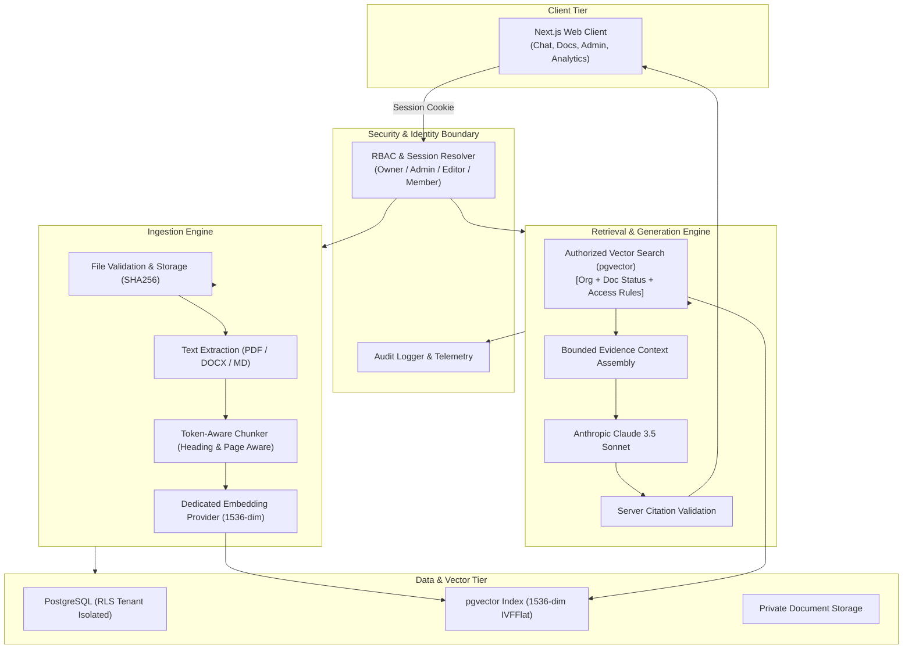

# Secure Internal Knowledge Hub (Enterprise RAG MVP)

[](https://www.typescriptlang.org/)
[](https://nextjs.org/)
[](https://www.anthropic.com/)
[](https://github.com/pgvector/pgvector)
[](https://vitest.dev/)
[](./SECURITY.md)

A private, multi-tenant AI knowledge assistant engineered for company Standard Operating Procedures (SOPs), employee handbooks, engineering incident protocols, compliance policies, and operational documentation.

Built with a **security-first retrieval architecture**, strictly grounded Anthropic Claude 3.5 generation, server-side validated source citations, explicit insufficient-evidence abstention, lifecycle document management, and administrative knowledge-gap observability.

---

## 🌟 Key Capabilities

1. **Permission-Aware Vector Retrieval Boundary**
   - Retrieval queries are filtered **at the database level** by tenant organization, document lifecycle status (`ready`), and fine-grained role/user access rules before chunks ever reach the LLM context.
   - Unauthorized chunks are never loaded into memory.

2. **Grounded Answer Generation & Citation Validation**
   - Versioned enterprise system prompt instructs Claude to answer exclusively from retrieved evidence.
   - Server-side citation verification matches every cited claim to real, accessible chunk IDs and formats rich previews with section headings and page numbers.

3. **Autonomous Abstention on Insufficient Evidence**
   - When documentation is missing or access is restricted, the assistant reliably abstains: *"I couldn't find enough information in the documents you have access to answer this reliably."*
   - Abstentions automatically feed into the **Knowledge Gaps** workflow for administrative review.

4. **Multi-Format Ingestion Pipeline**
   - Supports **PDF**, **DOCX**, **Markdown**, and **TXT** files.
   - Token-aware semantic chunker with heading path preservation (`#`, `##`, `###`), page number tracking, and sliding overlap.

5. **Document Lifecycle & Stale Chunk Invalidation**
   - Instant document retirement: retired documents are immediately unsearchable in retrieval without orphan chunk contamination.
   - In-place document re-indexing replaces obsolete chunk embeddings cleanly.

6. **Enterprise Governance & Observability**
   - Real-time Analytics Dashboard tracking query volume, user satisfaction, abstention rate, top-cited documents, and queried policy topics.
   - Immutable security audit stream logging all ingestion, permission, and role changes.

7. **Dual-Mode Zero-Config Engine**
   - **Local / Demo Mode**: Runs instantly out of the box with zero external dependencies (pure in-memory vector cosine math and deterministic embedding projection).
   - **Production Mode**: Seamlessly connects to **PostgreSQL + pgvector** on Supabase, **Anthropic Claude 3.5 Sonnet**, and **OpenAI/Voyage** embeddings via standard `.env` variables.

---

## 🏗️ Architecture Overview



---

## 🚀 Quickstart & Setup

### Prerequisites
- Node.js 18+ (tested on Node.js 24)
- npm or pnpm

### 1. Clone & Install
```bash
git clone https://github.com/your-org/secure-internal-knowledge-hub.git
cd secure-internal-knowledge-hub
npm install
```

### 2. Environment Configuration
By default, the application runs in local zero-config mode with synthetic SOP documents. To enable cloud services, copy `.env.example` to `.env.local`:
```bash
cp .env.example .env.local
```

### 3. Seed Demo Environment
Seed the database with realistic synthetic company documentation (PTO policy, engineering SEV-1 SOP, customer support SLA, password standards, executive compensation):
```bash
npm run seed
```

### 4. Start Development Server
```bash
npm run dev
```
Open [http://localhost:3000](http://localhost:3000) in your browser.

---

## 🧪 Testing & Evaluation

Execute the complete automated test suite (25 tests covering unit logic, security isolation, and RAG evaluation):

```bash
# Run all tests
npm test

# Run RAG evaluation suite specifically
npm run eval
```

### Evaluation Benchmark Summary

| Evaluation ID | Test Scenario | Expected Outcome | Status |
|---|---|---|---|
| **EVAL-01** | PTO Rollover Limits & Deadline | Exact 5 days & March 31st cited | ✅ PASS |
| **EVAL-02** | Priority 1 Urgent Ticket SLA | 15 min response time cited | ✅ PASS |
| **EVAL-03** | Remote Office Setup Stipend | $1,000 stipend & 30-day submission cited | ✅ PASS |
| **EVAL-04** | Out-of-Scope Query (Pet Policy) | Explicit Insufficient-Evidence Abstention | ✅ PASS |
| **EVAL-05** | Unauthorized Restricted Doc Query (Member) | Explicit Insufficient-Evidence Abstention | ✅ PASS |
| **EVAL-06** | Authorized Restricted Doc Query (Admin) | Grounded Answer with Executive Citations | ✅ PASS |
| **SEC-01** | Cross-Tenant Organization Query | 0 chunks returned (Strict Isolation) | ✅ PASS |
| **SEC-02** | Retired Document Query | 0 chunks returned (Immediate Exclusion) | ✅ PASS |
| **SEC-03** | Hostile Prompt Injection inside Document | Ignored as plain text without override | ✅ PASS |

---

## 📁 Project Structure

```
.
├── src/
│   ├── app/                    # Next.js App Router (pages & API routes)
│   │   ├── api/
│   │   │   ├── admin/          # Analytics, Members, Gaps, Audit routes
│   │   │   ├── auth/           # Session management & role switcher
│   │   │   ├── chat/           # RAG query execution endpoint
│   │   │   ├── conversations/  # Conversation persistence
│   │   │   ├── documents/      # Document upload & lifecycle routes
│   │   │   └── feedback/       # Feedback & gap reporting
│   │   ├── globals.css         # Tailwind enterprise dark theme
│   │   ├── layout.tsx          # Root layout
│   │   └── page.tsx            # Single-page shell
│   ├── components/             # React UI Components
│   │   ├── AdminAnalytics.tsx  # KPI charts and telemetry
│   │   ├── AdminMembers.tsx    # Role management
│   │   ├── AuditLogView.tsx    # Security audit stream
│   │   ├── ChatInterface.tsx   # Grounded chat with citation preview
│   │   ├── DocumentLibrary.tsx # Ingestion lifecycle table & upload
│   │   ├── IntegrationsView.tsx# Google Drive & SharePoint specs
│   │   ├── KnowledgeGaps.tsx   # Unanswered questions workflow
│   │   └── Sidebar.tsx         # Navigation & active persona switcher
│   ├── data/                   # Synthetic company documents
│   ├── lib/
│   │   ├── auth/               # RBAC role hierarchy & session handling
│   │   ├── chunking/           # Token-aware semantic chunker
│   │   ├── citations/          # Server-side citation validation
│   │   ├── db/                 # Memory & Supabase store adapters
│   │   ├── embeddings/         # Deterministic mock & OpenAI providers
│   │   ├── extraction/         # PDF, DOCX, TXT, MD text extractors
│   │   ├── ingestion/          # Multi-stage ingestion pipeline
│   │   ├── llm/                # Anthropic Claude 3.5 & system prompt
│   │   ├── rag/                # End-to-end RAG service
│   │   ├── seed/               # Seed data provisioner
│   │   ├── storage/            # Private object storage provider
│   │   └── types/              # Core domain TypeScript interfaces
├── supabase/
│   └── migrations/             # Production PostgreSQL + pgvector SQL migrations
├── tests/                      # Vitest test suites (unit, security, rag-eval)
├── docker-compose.yml          # Local PostgreSQL + pgvector container
└── package.json
```

---

## 🔒 Security Architecture Highlights

1. **Row Level Security (RLS)**: Enforces organization boundary and document visibility rules directly in PostgreSQL.
2. **Untrusted Document Handling**: Document text is formatted as passive evidence blocks; system prompt explicitly forbids executing instructions contained inside documents.
3. **Citation Integrity**: Frontends cannot manipulate citation links or view chunks from restricted documents without passing server authorization checks.
4. **Audit Trail**: Every document upload, access rule modification, role promotion, and RAG query generates an immutable audit record.

---

## 📄 Documentation Links

- [Architecture & Data Flow Diagrams](./ARCHITECTURE.md)
- [Security & Access Control Model](./SECURITY.md)
- [RAG Evaluation Suite & Groundedness](./EVALUATION.md)
- [Production Deployment Guide](./DEPLOYMENT.md)
- [Troubleshooting & FAQ](./TROUBLESHOOTING.md)
- [Client Presentation & Demo Script](./DEMO_SCRIPT.md)
